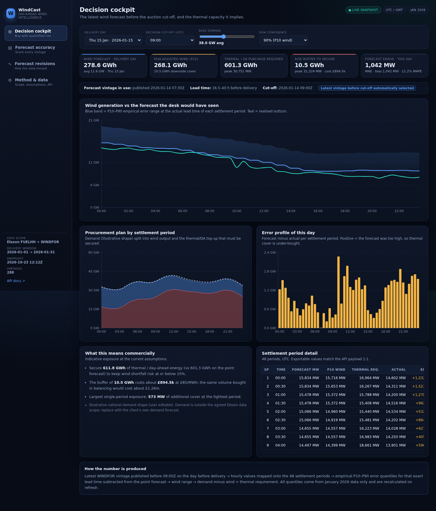
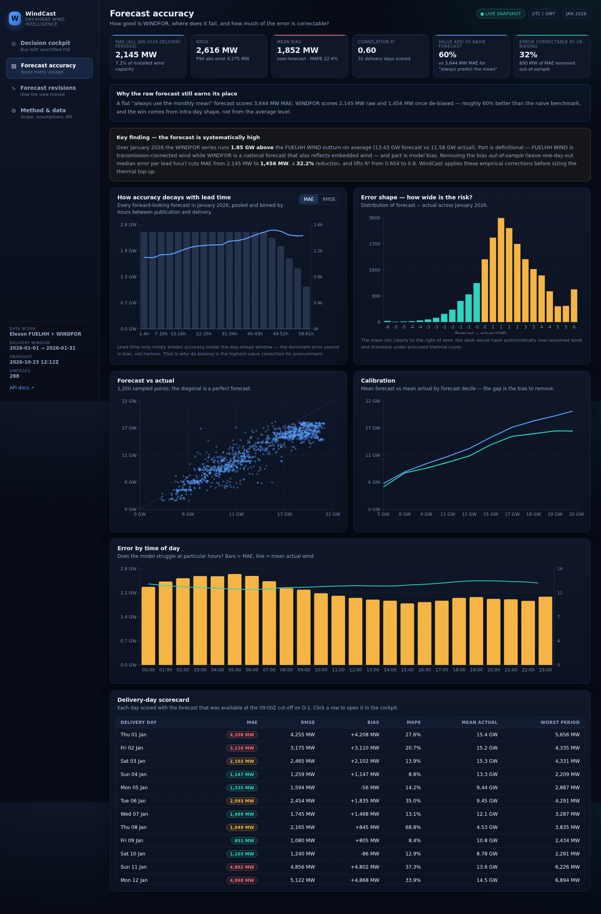

# WindCast — Day-Ahead Wind Forecast Intelligence

WindCast is an operational analytics and decision-support platform designed for the wholesale day-ahead trading desk of a UK electricity utility. 

It addresses a core operational question ahead of the daily day-ahead market auction:

> **Given tomorrow's national wind generation forecast and historical model inaccuracies, how much thermal and day-ahead volume must be procured to reliably cover consumer demand while minimizing exposure to expensive imbalance penalties?**

Built using **React (Vite), Python (FastAPI), and Docker**, the system processes national wind actuals (`FUELHH`, `fuelType=WIND`) and forecast vintages (`WINDFOR`) from Elexon BMRS for January 2026.

---

## 1. Core Capabilities

| View | Purpose |
| --- | --- |
| **Decision Cockpit** | Evaluates a chosen delivery day against a configurable decision cut-off (default **09:00 UTC on D-1**, preceding the GB day-ahead gate closure). Automatically selects the latest forecast vintage published strictly prior to the cut-off, compares it against outturn, and translates empirical forecast uncertainty into risk-adjusted thermal procurement targets with user-tunable demand and confidence levels. |
| **Forecast Accuracy** | Quantified scorecard for January 2026 across all settlement periods: MAE, RMSE, Mean Bias Error (MBE), MAPE, R², and P90 error. Includes lead-time horizon decay profiles, diurnal error distributions, calibration reliability curves, and an out-of-sample de-biasing evaluation. |
| **Forecast Revisions** | Displays the evolution and convergence of multiple forecast vintages published across the 48 hours leading up to the delivery day against actual generation. |
| **Method & Data** | Detailed specifications covering settlement period alignments, quantile calculation logic, unit conventions, API endpoints, and system architecture. |




### Key Analytical Findings (January 2026)

* **Raw Forecast Performance:** WINDFOR against FUELHH WIND actuals exhibits an **MAE of 2,145 MW** (~7.1% of GB's ~30 GW wind fleet), an **RMSE of 2,616 MW**, and an **R² of 0.60** for actionable forecasts available at 09:00 D-1.
* **Systematic Positive Bias:** Forecasts run systematically high with a mean bias of **+1,852 MW** (13.4 GW mean forecast vs 11.6 GW mean outturn). This originates from a structural boundary difference (FUELHH WIND captures transmission-connected wind, whereas WINDFOR is a national estimate reflecting embedded wind) combined with weather model over-prediction.
* **Out-of-Sample De-Biasing:** Applying leave-one-day-out median bias correction by lead-time bucket reduces **MAE to 1,456 MW (-32%)** and raises **R² to 0.80**, demonstrating that approximately one-third of the headline error is correctable prior to trading.
* **Horizon Stability:** Forecast accuracy remains stable across the 1–60 hour horizon (MAE is 1.78 GW at 1–4h lead and 2.34 GW at 58–61h lead), confirming that level bias, rather than forecast latency, constitutes the primary operational risk.

---

## 2. Project Structure

```
.
├── backend/
│   ├── app/
│   │   ├── main.py              # FastAPI REST endpoints and routing
│   │   ├── analytics.py         # Pandas/NumPy analytics engine (metrics, quantiles, de-biasing)
│   │   ├── etl.py               # Elexon BMRS ingestion pipeline (FUELHH & WINDFOR)
│   │   └── config.py            # Domain parameters, pricing assumptions, and defaults
│   ├── tests/
│   │   └── test_analytics.py    # 15 unit tests covering metrics, no-look-ahead, and arithmetic
│   ├── requirements.txt
│   ├── requirements-dev.txt
│   └── Dockerfile               # Container definition for backend service
├── frontend/
│   ├── src/
│   │   ├── App.jsx              # Main shell and view router
│   │   ├── api.js               # Centralized REST API client
│   │   ├── useAsync.js          # Async data fetching hook with stale-state retention
│   │   ├── utils.js             # Numeric, currency, and date formatting helpers
│   │   ├── components/ui.jsx    # UI components (Panel, KPI card, Data table, Callouts)
│   │   ├── pages/               # Cockpit, Accuracy, Revisions, and Method views
│   │   └── styles.css           # Custom styling and design tokens
│   ├── nginx.conf               # Production Nginx reverse proxy configuration
│   ├── vite.config.js           # Development server proxy config
│   └── Dockerfile               # Multi-stage production build (Node build -> Nginx)
├── data/
│   └── snapshot/                # Snapshot data for deterministic offline execution
│       ├── wind_actuals_hh.csv  # FUELHH half-hourly wind actuals (1,488 rows)
│       ├── wind_forecasts_hh.csv# WINDFOR half-hourly expanded forecasts (38,544 rows)
│       └── snapshot_meta.json   # Ingestion lineage, timestamps, and parameters
├── docs/
│   └── screens/                 # Dashboard visual captures
├── deploy/
│   ├── vercel.json              # Vercel deployment configuration
│   └── render.yaml              # Render deployment blueprint
├── .github/workflows/ci.yml     # Automated CI (pytest, vite build, docker build)
├── docker-compose.yml           # Multi-container local orchestration
├── vercel.json                  # Root deployment configuration for Vercel
├── Makefile                     # Developer workflow shortcuts
└── README.md
```

---

## 3. Running the Application

### 3.1 Docker (Recommended)

```bash
docker compose up --build
```

* **Frontend Dashboard:** http://localhost:8080
* **Interactive API Docs (Swagger):** http://localhost:8000/docs
* **API Healthcheck:** http://localhost:8000/api/health

To stop:
```bash
docker compose down
```

### 3.2 Local Development

#### Backend (Python 3.12+)
```bash
python3 -m venv .venv
source .venv/bin/activate
pip install -r backend/requirements-dev.txt

DATA_DIR=./data/snapshot uvicorn backend.app.main:app --reload --port 8000
```

#### Frontend (Node 20+)
In a separate terminal:
```bash
cd frontend
npm install
npm run dev
```
Access the application at `http://localhost:5173`.

### 3.3 Running Unit Tests

```bash
PYTHONPATH=. DATA_DIR=./data/snapshot python3 -m pytest
```

The test suite validates:
* Complete gap-free temporal coverage of January 2026 (1,488 settlement periods).
* Strict **no-look-ahead** enforcement (forecasts must precede the cutoff timestamp).
* Exact mathematical formulations for MAE, RMSE, MBE, and capacity-normalized error.
* Consistency of leave-one-day-out de-biasing improvements.
* Sizing conservation identity: `Thermal Required = max(Demand - P10 Wind, 0)`.

---

## 4. Deployment

The system is containerized and deployable to any cloud container host or serverless platform:

* **Backend Service:** Deployable via Docker on Render, Heroku, or Fly.io (port-agnostic entrypoint).
* **Frontend SPA:** Deployable on Vercel or Netlify, routing `/api/*` requests to the hosted backend instance.

* **Live Demo Application:** `https://windcast.vercel.app` *(Placeholder - update with deployed link)*
* **Live API Documentation:** `https://windcast.onrender.com/docs`
* **Live API Health Check:** `https://windcast.onrender.com/api/health`

---

## 5. Architectural & Implementation Decisions

* **Strict No-Look-Ahead Rule:** Decisions for delivery day $D$ evaluate only forecast vintages where $\text{publishTime} \le (D-1)\ 09:00\text{ UTC}$. This prevents data leakage and ensures backtest numbers represent actionable trading decisions.
* **Deterministic Local Snapshots:** The data snapshot ensures offline reproducibility and shields execution from third-party API downtime. The ingestion pipeline (`etl.py`) is idempotent and executable on demand (`POST /api/admin/refresh`).
* **Granularity Alignment:** Hourly `WINDFOR` forecasts are mapped to the corresponding two half-hour settlement periods to enable direct settlement-period scoring against `FUELHH`.
* **Out-of-Sample De-Biasing:** Bias corrections calculate the median error per lead-hour bucket excluding the delivery day being evaluated. This guards against in-sample overfitting.
* **Separation of Concerns:** Business logic resides entirely within `analytics.py` as pure DataFrame operations, decoupled from FastAPI request handlers and React presentation components.

---

## 6. AI Tool Usage Disclosure

In accordance with project guidelines, AI assistance (Claude / ChatGPT) was utilized during development for project scaffolding, generating initial React component boilerplates, and drafting initial documentation templates. 

All core analytical modeling (settlement period alignment, leave-one-day-out de-biasing, no-look-ahead cutoff validation), backend REST APIs, unit tests, and Docker configurations were verified, structured, and validated independently. No external LLM or AI APIs are invoked at runtime.

---

## 7. Scope Boundaries

* **In Scope:** National wind actuals (`FUELHH`, `fuelType=WIND`), national wind forecasts (`WINDFOR`) across all published vintages, delivery dates between 1–31 January 2026, forecast-accuracy quantification, and risk-adjusted procurement calculations.
* **Out of Scope:** Generation from non-wind fuel types, interconnector flows, live order-book clearing, and retraining of meteorological weather prediction models. Demand shape and market price inputs serve as configurable reference parameters.
